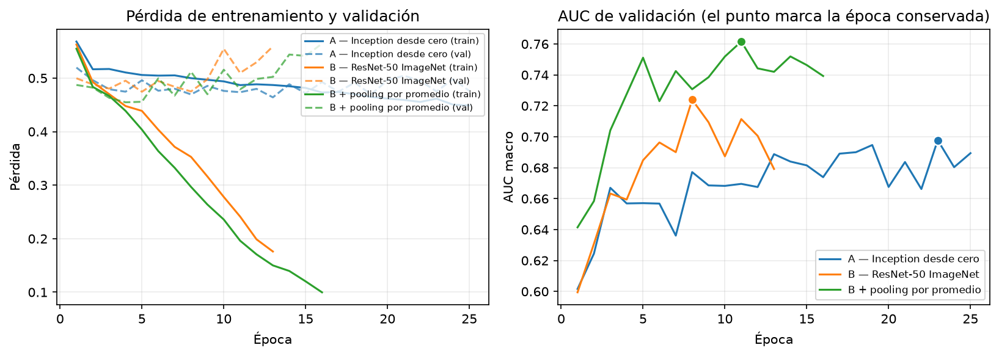

# Paso 3 — Las dos arquitecturas

Resuelve el **entregable #2**:

> Implementación y entrenamiento de al menos **dos arquitecturas** de clasificación
> multietiqueta: una **CNN diseñada desde cero** (2D o 2.5D) y una basada en
> **transfer learning con backbone preentrenado en ImageNet**, adaptado con **doce
> salidas sigmoides independientes**.

## Clases y módulos de este paso

| Archivo | Clase / función | Qué hace |
|---|---|---|
| [`datos.py`](datos.py) | `DatasetRodilla`<br>`Registro`<br>`cargar_registros()` | Lee el caché del paso 2 como dataset de PyTorch. Aumento = flip horizontal |
| [`pooling.py`](pooling.py) | `AtencionPooling`<br>`PromedioPooling`<br>`SalidaPooling` | **Escrito desde cero**: pasa de 8 grupos de cortes a un embedding por estudio |
| [`inception.py`](inception.py) | `EncoderInception`<br>`BloqueInception`<br>`AnchosInception` | **Escrito desde cero**: encoder Inception, 4 bloques, 0.58M parámetros |
| [`modelos.py`](modelos.py) | `ClasificadorRodilla`<br>`EncoderResNet50`<br>`construir_modelo()` | Une encoder + pooling + 12 sigmoides |
| [`perdidas.py`](perdidas.py) | `PerdidaFocal`<br>`pesos_por_prevalencia()`<br>`construir_perdida()` | BCE, BCE ponderada y focal, para la ablación |
| [`particion.py`](particion.py) | `Particion`<br>`particionar()`<br>`pliegues()` | Train/val sobre etiquetas débiles, dorados reservados como prueba |
| [`entrenamiento.py`](entrenamiento.py) | `Entrenador`<br>`ConfigEntrenamiento`<br>`Historial` | Bucle compartido por ambas arquitecturas, con early stopping |
| [`entrenar.py`](entrenar.py) | `main()` | Script ejecutable |
| [`validacion_cruzada.py`](validacion_cruzada.py) | `main()`<br>`correr_pliegue()` | Script ejecutable: 5 pliegues sobre las etiquetas débiles |
| [`graficar_curvas.py`](graficar_curvas.py) | `graficar()` | Script ejecutable: curvas de pérdida y AUC por época |
| [`verificar_determinismo.py`](verificar_determinismo.py) | `comparar(...)`<br>`main()` | Script ejecutable: corre dos veces la misma configuración y compara época por época. Escribe `determinismo.json` |

Las métricas viven en [`../paso4_evaluacion/metricas.py`](../paso4_evaluacion/metricas.py)
porque son del paso de evaluación; este paso las importa para vigilar el AUC de
validación entre épocas.

## Comandos

```bash
# A — CNN desde cero
.venv/Scripts/python.exe pregunta1/paso3_modelos/entrenar.py --modelo inception --epocas 25

# B — transfer learning con ImageNet
.venv/Scripts/python.exe pregunta1/paso3_modelos/entrenar.py --modelo resnet50 --epocas 25

# variantes para la ablación del paso 5
.venv/Scripts/python.exe pregunta1/paso3_modelos/entrenar.py --modelo resnet50 --perdida focal
.venv/Scripts/python.exe pregunta1/paso3_modelos/entrenar.py --modelo resnet50 --pooling promedio
.venv/Scripts/python.exe pregunta1/paso3_modelos/entrenar.py --modelo resnet50 --sin-preentrenar
```

Cada corrida guarda `pesos.pt` e `historial.json` en `corridas/<etiqueta>/`.

### Verificar que el entrenamiento es reproducible

```bash
# entrena dos veces la misma configuracion y compara epoca por epoca
.venv/Scripts/python.exe pregunta1/paso3_modelos/verificar_determinismo.py

# la contraprueba: sin el arreglo, las dos corridas divergen
.venv/Scripts/python.exe pregunta1/paso3_modelos/verificar_determinismo.py --sin-determinismo
```

Devuelve codigo 1 si las dos corridas no coinciden bit a bit, de modo que sirve
como etapa del pipeline y no solo como diagnostico manual.

### Validación cruzada de 5 pliegues

```bash
.venv/Scripts/python.exe pregunta1/paso3_modelos/validacion_cruzada.py --modelo inception
.venv/Scripts/python.exe pregunta1/paso3_modelos/validacion_cruzada.py --modelo resnet50 --pooling promedio
```

Acumula en `validacion_cruzada.json` en vez de pisarlo, para comparar
configuraciones. Unos 9 minutos por configuración.

### Usar las clases desde Python

```python
from pregunta1.paso3_modelos.modelos import construir_modelo
import torch

modelo = construir_modelo("resnet50", pooling="atencion")
salida = modelo(torch.randn(2, 8, 3, 224, 224))

salida.logits           # (2, 12)
salida.atencion         # (2, 8)  -- que corte miro el modelo
salida.probabilidades() # (2, 12) tras sigmoide
```

---

## Lo que se hizo

### La arquitectura, común a las dos

```
entrada (B, 8, 3, 224, 224)      8 grupos de 3 cortes contiguos
   ↓ encoder                      Inception propia  /  ResNet-50 ImageNet
features (B, 8, D)
   ↓ pooling                      ESCRITO POR NOSOTROS
embedding (B, D)
   ↓ cabeza lineal                ESCRITO POR NOSOTROS
12 logits sigmoides
```

**Solo cambia el encoder.** Mismo preprocesamiento, mismo pooling, misma cabeza,
mismo bucle, misma semilla, mismos hiperparámetros. El entregable #3 pide comparar
"de forma rigurosa", y eso solo se sostiene si varía una sola cosa.

### A — Inception desde cero

Derivada de GoogLeNet (`doc/GooGleNet.pdf`) y del lab del curso
`notebooks/Lab_VGGNet_GoogLeNet.ipynb`. Nada copiado de cuadernos públicos.

Se eligió Inception sobre una pila residual por una razón concreta: sus ramas
paralelas ven campos receptivos de 1×1, 3×3 y 5×5 **a la misma profundidad**. Los
hallazgos de rodilla viven a escalas muy distintas —una rotura meniscal son unos
milímetros, un derrame ocupa toda la cápsula— y con 576 estudios capturar ambas
sin profundizar vale más que la profundidad pura.

Las reducciones 1×1 antes de las ramas 3×3 y 5×5 son el punto de la variante
"reduced": sin ellas el conteo de parámetros explota, que es justo lo que 576
estudios no toleran.

Cuatro bloques, **0.58M parámetros** en el encoder (0.7M el modelo completo).
Más chica que la GoogLeNet original a propósito: nueve bloques sobreajustarían.

### B — ResNet-50 con ImageNet

El examen la nombra textualmente. Se descarta la cabeza de clasificación y se usa
la característica agrupada de 2048 dimensiones. **24.1M parámetros.**

La entrada son tres cortes contiguos en vez de RGB — por eso el paso 2 agrupa de a
tres: la primera convolución preentrenada se carga **sin tocar**.

### El pooling por atención — lo que exige implementar el examen

> "los componentes principales de la arquitectura deben ser implementados por el
> estudiante"

Una **media** sobre grupos diluiría el hallazgo: una rotura meniscal abarca 2 o 3
cortes de 30, así que promediar la ahoga en tejido sano. Un **máximo** se quedaría
con un solo grupo y tiraría la evidencia que lo corrobora, además de ser frágil
ante un corte ruidoso.

La atención **aprende qué grupos mirar**, con compuerta (la rama sigmoide) para
suprimir un grupo irrelevante aunque tenga puntaje alto. Y deja un rastro
auditable: los pesos dicen **qué corte** usó el modelo, que se complementa con
Grad-CAM diciendo **dónde dentro de ese corte**.

### El entrenamiento no era reproducible, y eso invalidó conclusiones

`fijar_semilla()` sembraba `random`, `numpy` y `torch`, y eso **no alcanza en
GPU**. cuDNN elige sus kernels en tiempo de ejecución y varios acumulan en orden
no determinista, así que dos corridas de la misma configuración, con la misma
semilla y los mismos datos, dan resultados distintos.

Medido con `verificar_determinismo.py`, tres épocas de `resnet50 + atención`:

```bash
# las filas no deterministas (cada corrida da una magnitud distinta)
.venv/Scripts/python.exe pregunta1/paso3_modelos/verificar_determinismo.py \
  --sin-determinismo --epocas 3 \
  --salida pregunta1/paso3_modelos/determinismo_sin_arreglo.json
# la fila determinista
.venv/Scripts/python.exe pregunta1/paso3_modelos/verificar_determinismo.py --epocas 3
```

La tabla del informe (`tablas/determinismo.tex`) se genera desde el primero y el
tercero de esos archivos, no desde valores escritos a mano.

| entorno | primera diferencia | mejor AUC (1) | mejor AUC (2) | mayor Δ | archivo |
|---|---|---:|---:|---:|---|
| Solo sembrando los generadores | **época 1** | 0.6501 | 0.6801 | **4.1e-02** | `determinismo_sin_arreglo.json` |
| Solo sembrando, segunda medición | **época 1** | 0.5919 | 0.5759 | **1.6e-02** | `determinismo_sin_fijar.json` |
| Con kernels deterministas | idénticas | 0.6633 | 0.6633 | **0** | `determinismo.json` |

**La magnitud del ruido no se repite, y eso es parte del hallazgo.** Se midió dos
veces la misma cosa y dio 0.041 y 0.016; el docstring de
`verificar_determinismo.py` registra además un tercer caso histórico del proyecto
(AUC 0.743 contra 0.707, o 0.036). Siendo no determinista, el **tamaño** del salto
tampoco es reproducible:

| medición | mayor Δ | supera a … de las 7 comparaciones de la ablación |
|---|---:|---|
| `determinismo_sin_arreglo.json` | 0.041 | 4 |
| caso histórico del docstring | 0.036 | 4 |
| `determinismo_sin_fijar.json` | 0.016 | 1 |

Lo único que se reproduce con seguridad es que **difieren desde la época 1**, y
eso alcanza para la conclusión. Incluso el menor de los tres valores (0.016) es
del mismo tamaño que la comparación más chica de la ablación (focal vs. BCE con
promedio, 0.0163).

Mientras los kernels no estén fijados, esas comparaciones no distinguen el efecto
que buscan del ruido del entorno de ejecución — y el bootstrap no lo advierte,
porque mide la variabilidad del muestreo de estudios, no la de la ejecución.

**Corrección.** Este README afirmaba que 0.041 superaba a *"cinco de las siete"*
comparaciones. Contra `paso4_evaluacion/comparaciones.json`, las supera a
**cuatro**. (El "cinco de siete" sí es correcto en otro contexto, y el informe lo
usa bien: son cinco las comparaciones que quedan **sin significancia**, que es
otra cuenta.) La fila original de la tabla, en cambio, **estaba bien y estaba
respaldada** por `determinismo_sin_arreglo.json`; la segunda fila es una medición
nueva que se agregó para mostrar que la magnitud varía.

El arreglo, en `fijar_semilla(semilla, determinista=True)`:

```python
os.environ.setdefault("CUBLAS_WORKSPACE_CONFIG", ":4096:8")
torch.backends.cudnn.deterministic = True
torch.backends.cudnn.benchmark = False
torch.use_deterministic_algorithms(True, warn_only=False)
```

`CUBLAS_WORKSPACE_CONFIG` se lee al crear el handle de cuBLAS, así que tiene que
estar puesto **antes** de cualquier trabajo con CUDA; por eso vive dentro de
`fijar_semilla` y no donde se construye el modelo.

El costo resultó despreciable: 2.4 minutos por corrida contra 2.2 sin fijar nada.
Lo que se creía caro no lo era, y lo que se creía gratis —reportar una ablación
sobre corridas irreproducibles— costó un conjunto de conclusiones.

**Qué cambió al rehacer todo de forma determinista** (detalle en el
[paso 5](../paso5_ablacion_gradcam/README.md)): de las siete comparaciones de la
ablación, **cuatro cambiaron de veredicto**. Las dos que ahora son significativas
—ImageNet y plano de la resonancia— antes no lo eran, y las dos que lo eran
—agregación y pérdida focal— dejaron de serlo.

### Resultados del entrenamiento

| Modelo | Parámetros | Mejor época | AUC val (1 partición) | Tiempo |
|---|---|---|---|---|
| Inception desde cero | 0.7M | 23 | 0.6978 | 2.4 min |
| ResNet-50 ImageNet | 24.06M | 8 | 0.7240 | 1.5 min |
| ResNet-50 + promedio | 23.53M | 11 | **0.7616** | 1.8 min |

Las tres son **deterministas y verificadas**: repetir el comando da el mismo
número.

~7 s por época en la RTX PRO 5000 Blackwell.

### Validación cruzada: las cifras de una sola partición eran optimistas

Todas las decisiones iniciales se tomaron sobre una única división 80/20 de los
estudios con etiqueta débil. Con los cinco pliegues:

| Configuración | 1 partición | CV 5 pliegues | Delta |
|---|---|---|---|
| Inception | 0.6978 | **0.6717 ± 0.0150** | -0.0261 |
| ResNet-50 + atención | 0.7240 | **0.6975 ± 0.0143** | -0.0264 |
| ResNet-50 + promedio | 0.7616 | **0.7354 ± 0.0125** | -0.0262 |

**Las tres cifras estaban infladas entre 0.026 y
0.026 puntos.** La partición única había caído en el lado
favorable en los tres casos, lo cual no es casualidad: es la misma partición, y
si favorece a una configuración favorece a todas.

**El ordenamiento se conserva** —promedio > atención > Inception— de modo que las
conclusiones de la ablación no cambian; lo que cambia es la magnitud declarada.

#### El mejor modelo es también el más estable

| Configuración | Desviación entre pliegues |
|---|---|
| ResNet-50 + promedio | ± 0.0125 |
| ResNet-50 + atención | ± 0.0143 |
| Inception | ± 0.0150 |

La desviación entre pliegues es la escala con la que hay que leer cualquier
diferencia medida sobre una sola partición: una brecha de 0.02 entre dos
configuraciones está dentro de lo que cambia al mover la partición.

---

## Hallazgos

### ResNet-50 sobreajusta de forma severa

```
resnet50 + atención, última época (13):  train 0.1760  |  val 0.5592   -> 3.2x
resnet50 + promedio, última época (16):  train 0.0997  |  val 0.5643   -> 5.7x
```

La pérdida de entrenamiento cae 3.2× desde la primera época mientras la de
validación sube. Con 416 estudios de entrenamiento y 24.1M parámetros era
previsible. El early stopping devuelve los pesos de la **mejor época (8)**, no
los últimos — el mismo problema que ya habíamos visto en MNIST.

La Inception, con 0.7M parámetros, no muestra esa divergencia: train 0.4489
contra val 0.4760 al final, una brecha de 1.1×.

**Corrección.** Una versión anterior de este README decía *"época 24: train
0.0188 | val 0.5671"*, una caída de *"30×"*, y que la mejor época era la **19**.
`corridas/resnet50_bce_atencion/historial.json` tiene **13 épocas**, no 24; su
última es `train 0.1760 / val 0.5592`, y su mejor época es la **8**. Los números
viejos son internamente consistentes entre sí (0.5671/0.0188 = 30.2), así que
venían de una corrida más larga que la detención temprana después acortó y que ya
no está en el repositorio.

### Dos estudios dorados se perdieron en el camino

La partición reporta `prueba(dorados)=56`, no 58: dos de los dorados están entre
los 24 estudios sin serie sagital fluid-sensitive que el paso 2 descartó. El
conjunto de prueba final son **56 estudios**, y así se reporta.

### La validación usa etiquetas débiles, no verdad

El AUC de validación (0.70–0.76) se mide contra las etiquetas del extractor, que
tienen **26.0% de ruido**. No es comparable con el AUC sobre los dorados, que se
mide contra radiólogos. Sirve para **elegir**, no para reportar — es la regla
metodológica del proyecto.

### Curvas de entrenamiento

```bash
.venv/Scripts/python.exe pregunta1/paso3_modelos/graficar_curvas.py
```



El panel izquierdo muestra el sobreajuste con claridad. La brecha final entre
pérdida de validación y de entrenamiento:

| configuración | train final | val final | brecha val/train |
|---|---:|---:|---:|
| Inception desde cero | 0.4489 | 0.4760 | **1.1×** |
| ResNet-50 + atención | 0.1760 | 0.5592 | 3.2× |
| ResNet-50 + promedio | 0.0997 | 0.5643 | **5.7×** |

Inception, con 0.7M parámetros, mantiene ambas curvas juntas. **ResNet-50 con
promedio es la que más sobreajusta de las tres**, no la de atención: lleva la
pérdida de entrenamiento a 0.0997 mientras la de validación se queda en 0.5643.
El panel derecho marca con un punto la época que la detención temprana conserva.

**Una brecha más grande que todas estas, que no cuenta:** `resnet50_focal` llega
a 9.1× (train 0.0067, val 0.0615). No es comparable con las de arriba porque la
pérdida focal opera en otra escala absoluta —sus dos pérdidas son un orden de
magnitud más chicas— así que el **cociente** entre ellas no mide lo mismo que en
BCE. Las brechas solo se comparan entre corridas con la misma función de pérdida.

**Corrección.** Una versión anterior de esta tabla daba ResNet-50 + promedio en
5.3× y ResNet-50 + atención en **30.2×**, e invertía la conclusión: decía que la
de atención era la que más sobreajustaba. Medido sobre los `historial.json`, la
de atención está en **3.2×** y la de promedio en **5.7×**, o sea al revés.

Nótese que la configuración con **menor** brecha no es la mejor: Inception no
sobreajusta porque no tiene capacidad suficiente para hacerlo, y su AUC es el más
bajo de los tres.

---

## Pendiente

| | Qué falta | Por qué importa |
|---|---|---|
| 1 | ~~Validación cruzada de 5 pliegues~~ | ✅ **hecho** — las cifras de una partición estaban infladas 3–5 puntos |
| 2 | ~~Curvas de entrenamiento como figura~~ | ✅ **hecho** — `figuras/curvas_entrenamiento.png` |
| 3 | ~~Variante coronal~~ | ✅ **hecho** — ver la ablación de plano en el [paso 5](../paso5_ablacion_gradcam/README.md) |
